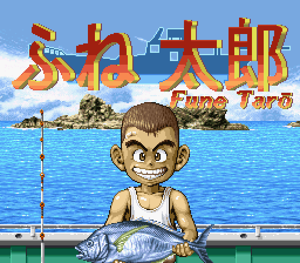
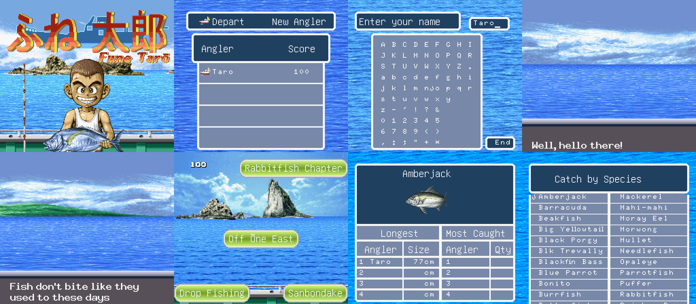

# Fune Tarou (English)
English translation of *Fune Tarou* (ふね太郎, Pack-In-Video, 1997), a Super Famicom boat-fishing game from
the makers of *Tsuri Tarou* and the Nushi Tsuri / River King series. You fish from a boat around the Izu islands,
working through chapters for each fish, and the game keeps per-fish records for up to four anglers.
Everything a player reads is in English:
- the title menu and the name-entry keyboard;
- the opening speech, set in a wider, proportional font;
- the stage labels (style, chapter, spot and island);
- all 52 fish, plus the lures and baits;
- the catch and New Record messages, the records screen and the catch list;
- the sound test and the save-error message.

The Japanese title logo stays, with a hand-drawn English subtitle under it in the logo's own colors.

## Base game
- Platform: Super Famicom (SNES), HiROM
- Required file: `Fune Tarou (Japan).sfc`
- Size / header: 2,097,152 bytes (16 Mbit), no copier header
- CRC32: `5D6BA598` / SHA-1: `2c26f7432fe35c58545063ae44ea7daacbd50de3`
- Patched result CRC32: `B440B1B2` / SHA-1: `b4485371a627a90c7bc7500b12d4c8c394c29c1c` (4,194,304 bytes)

## How to apply
Apply `patches/FuneTarou_SFC_EN_v1.0.bps` with Floating IPS (Flips), beat or Rom Patcher JS. If your file is
2,097,664 bytes, it has a 512-byte copier header: remove it first. BPS checks the input and refuses a wrong
file. The patched ROM is 32 Mbit HiROM. The new upper half is used for the English text, code and fonts, and
any current SNES emulator or flash cart runs it.

Saves from the Japanese game load, but angler names typed in kana show as odd symbols. Start a new angler for
English names.

## Status and testing
Version 1.0, tested only in an emulator (snes9x through stable-retro, driven by scripts), not on hardware.

Seen on screen:
- the title, title menu and name entry;
- the whole opening speech;
- the stage labels and the HUD;
- the records screen and the catch list.

The catch result window (fish name, size, New Record!) and the lure window were seen with test copies of the
ROM that open them on demand. A normal catch in play was not waited out.

Not seen on screen: GAME OVER, the hidden sound test and the "Records were erased." message. Their text is in
place and uses the same paths as the screens above.

The project lead reviewed screenshots of every screen above, and the text placement and fonts were reworked
after that review.

No known issues.

## Build on this
`src/BUILD.md` rebuilds the patch from your ROM with one command (Python 3 and Pillow). The build was checked
byte for byte against the published BPS.

`docs/ENGINE_NOTES.md` covers:
- the text engine, the compression format and the three fonts;
- every hook and its address;
- the free space and RAM used.

`src/script/` has every string in Japanese and English, and `DEVLOG.md` tells how the patch was made.

## About AI use
This project was made with substantial help from Claude (Anthropic). Claude did the following:
- reverse-engineered the text, list, speech and title code;
- wrote the English script and glossary;
- wrote the build tools and 65816 hooks;
- adapted and drew the fonts, and drew the title subtitle by hand;
- tested everything in an emulator.

The project lead chose the game and set the style rules. The lead reviewed the screenshots, which led to the
rework of the box fonts and the opening-speech font. The lead approved the glossary and chose to keep the
Japanese logo with an English subtitle under it.

## License
Code, tools and docs made for this project: MIT. Translation text and new art: CC BY 4.0. Extracted game material
remains the property of its rights holders and is included for research and modding.

Font sources:
- GNU Unifont (the tall box font): GPL 2+ with the font embedding exception, or SIL OFL 1.1.
- X11 misc-fixed 6x10 and 9x15 bold (the compact font and the speech font): public domain.

The romhack toolkit in `src/toolkit/` is MIT.

## Credits
- Translation, ROM hacking, tools and the title subtitle: Claude (Anthropic), with the project lead.
- Fish names follow the English Umi no Nushi Tsuri (Sea King) patch in this repository, so the series reads the same.
- Fonts: GNU Unifont, X11 misc-fixed.
- Tools: Python, Pillow, stable-retro / snes9x (testing), Capstone (disassembly), and the included rhtk toolkit (BPS).
- Original game © 1997 Pack-In-Video. Unofficial fan translation.

## Changelog
- 1.0 (2026-11-22): first release.
