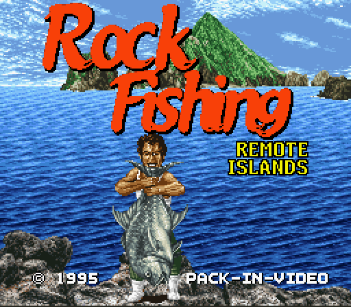

# Rock Fishing: Remote Islands (Iso Tsuri: Ritou-hen) — English translation

A complete English translation of *Iso Tsuri: Ritou-hen* (磯釣り 離島篇, Pack-In-Video, 1995), the Super Famicom
rock-fishing spin-off of the Nushi Tsuri / River King series, set on the islands off Izu. Every menu, the name
entry, the records screens, the catch screen, all fish, bait, method, island and spot names, and the opening and
ending story are in English. The title logo is redrawn by hand as "Rock Fishing / Remote Islands".

## Base game
- Platform: Super Famicom
- Required file: `Isozuri - Ritou Hen (Japan).sfc` (No-Intro)
- Size / header: 2,097,152 bytes, no copier header
- CRC32: `3D35D085` / SHA-1: `49741c14e923bdaa0ff5776744508544921cbb2d`
- Patched result: 4,194,304 bytes (expanded to 32 Mbit), CRC32 `1D167192` / SHA-1 `ed32c85e7af1da0dc8162d9b8a9a88816d23d696`

## How to apply
Apply `patches/IsoTsuri_RitouHen_SFC_EN_v1.0.bps` to the ROM above with Flips, beat or
[Rom Patcher JS](https://www.marcrobledo.com/RomPatcher.js/). If your dump has a 512-byte copier header
(2,097,664 bytes), remove it first. BPS checks the input, so a wrong ROM is refused rather than half-patched.

## Status and testing
Version 1.0.
- Tested in emulators only, not on real hardware.
  - Claude checked every screen in snes9x (stable-retro): title, menu, name entry, the whole opening, the sea and
    island maps with their labels, fishing view, underwater view, records by island and by fish, record lists,
    catch result, ending and the erased-records message. The spot labels, catch screen and ending were first
    reached with test builds.
  - The project lead played it, including a real catch with a new record ("Everything looks good").
- Fishing plays exactly like the Japanese game. Claude ran both ROMs in lockstep from the same save state with the
  same inputs (a long wait, a bite and the underwater scene), and their RAM matched apart from the patch's own
  scratch area.
- Known limits:
  - Names typed in the Japanese game's save data still show in kana.
  - Record lines drop the rank number to make room for English spot names.
  - The story crawls run a little faster per letter than the Japanese did, since English text is longer. Hold A
    to speed them up.

Fishing tip: hold A longer to cast farther and steer with Left/Right while the rig flies. The small dark spots on
the water are fish, and the rig has to land near one to get a bite.

## Build on this
- `src/BUILD.md`: one-command rebuild from a clean ROM. Verified byte for byte against the published patch.
- `docs/ENGINE_NOTES.md`: text engine, control codes, fonts, LZ format, title screen, records, fishing variables,
  and every hook with its address.
- `src/script/`: Japanese and English for every string and table (JSON, plus `script.tsv` for reading).
- `DEVLOG.md`: how it was made, what went wrong and who decided what.

## About AI use
This project was made with substantial help from Claude (Anthropic). Claude:
- reverse-engineered the text engine;
- wrote the tools, the hooks and the English script;
- drew the title lettering;
- tested every screen in an emulator.

The project lead:
- chose to make the patch and supplied the ROM;
- set the series conventions (fish names from the Sea King patch) and the no-fonts rule for redrawn art;
- reviewed the logo and the crawl font;
- playtested the game.

## License
Code, tools and docs made for this project: MIT. Translation text and new art: CC BY 4.0. Extracted game material
(Japanese script, original title graphics) remains the property of its rights holders and is included for research
and modding.

## Credits
- Translation, ROM hacking and title lettering: Claude (Anthropic), for the project lead.
- Fish names: the series glossary of the *Super Legend of the Sea King* patch in this repository.
- Fonts:
  - X11 koi8x16 (from xfonts-cyrillic, free to distribute and modify) for menus.
  - The story font is derived from X11 misc-fixed 9x15 bold (public domain) and shared with the Fune Tarou patch.
- Tools: snes9x via stable-retro (testing), Pillow, and the `rhtk` BPS writer (included).
- Original game © 1995 Pack-In-Video. This is an unofficial fan translation; share the patch, not patched ROMs.

## Changelog
- 1.0 (2026-11-23): first release.
