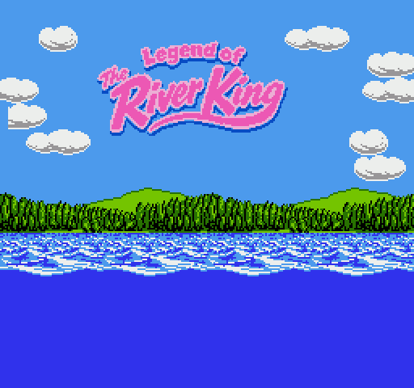
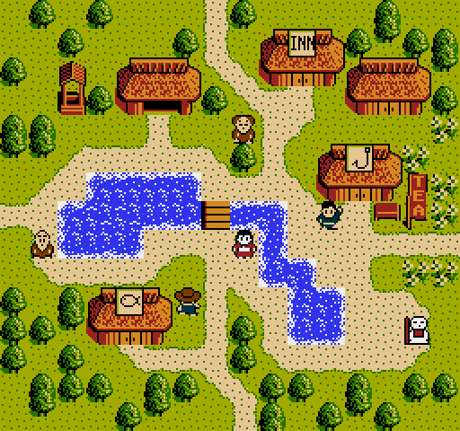

# Legend of the River King (Famicom)
English translation of *Kawa no Nushi Tsuri* (川のぬし釣り, Pack-In-Video, 1990), the first game of the Nushi Tsuri /
River King fishing RPG series. Everything a player reads is in English: all dialogue, the opening story and the
ending, every menu, the shops and fish buyer, all 59 fish and 22 creatures, the town signs and a new title logo.
English lines use both rows of the text box, so most sentences read in one go.

 

## Base game
- Platform: Famicom (NES), mapper 4 (MMC3)
- Required file: `Kawa no Nushi Tsuri (Japan).nes`
- Size / header: 262,160 bytes with the 16-byte iNES header (the patch expects the header)
- CRC32: `4F5C3D34` / SHA-1: `8ad15b4d26610d164f19754e15f9afb8c1804796`
  (without the header: CRC32 `F4E5DF0E`, the No-Intro checksum)
- Patched result CRC32: `27F72AA2` / SHA-1: `65d1ab2ea1f6672669a566d4803e3efbedf6a95c` (393,232 bytes)

## How to apply
Apply `patches/KawaNoNushiTsuri_FC_EN_v1.0.bps` with Floating IPS (Flips), beat or Rom Patcher JS. If your ROM
has no iNES header (32 KiB smaller, CRC32 `F4E5DF0E`), add one first; BPS checks the input and refuses a wrong
file. The patched ROM is 384 KiB (program ROM expanded from 128 to 256 KiB, still MMC3), which any current NES
emulator or flash cart that supports MMC3 runs.

Passwords use only digits and `*`, so passwords from the Japanese game work in the English one and back.

## Status and testing
Version 1.0. Tested only in an emulator (the headless cynes core, driven by scripts), not on hardware:
title screen, intro, town and signs, every command window, eating, buying in a shop, the fish buyer, battles
and their messages, casting, the reeling window and the catch messages. To see the reeling and catch screens
quickly, a test copy of the ROM was made to bite at once; a normal bite was not waited out. The ending and the
in-battle Eat list were not seen on screen; their text and windows are built the same way as the parts that
were. No known issues.

## Build on this
`src/BUILD.md` rebuilds the patch from your ROM with one command (Python, Pillow, cc65); the build was checked
byte for byte against the published BPS. `docs/ENGINE_NOTES.md` has the ROM map, text engine, hooks and RAM used,
`src/script/script.tsv` has every line in Japanese and English, and `DEVLOG.md` tells how it was made.

## About AI use
This project was made with substantial help from Claude (Anthropic): Claude reverse-engineered the text and
menu engine, wrote the English script, the build tools and 6502 hooks, drew the font, signs and the first title
logo, and tested everything in an emulator. The project lead chose the game, set the direction and the series
naming rules, reviewed the result and supplied the final title logo.

## License
Code, tools and docs made for this project: MIT. Translation text and new art: CC BY 4.0. Extracted game material
remains the property of its rights holders and is included for research and modding.

## Credits
- Translation, ROM hacking and tools: Claude (Anthropic), with the project lead
- Title logo: the project lead
- Earlier translations of this game, with thanks: Disconnected Translations v0.15 (1999, menus) and
  Pikachumanson v0.91 (2013). This patch is a new translation and does not use their files.
- Tools: cc65 (ca65/ld65), Pillow, cynes (testing), the included rhtk toolkit (BPS)
- Original game © 1990 Pack-In-Video. Unofficial fan translation.

## Changelog
- 1.0 (2026-11-22): first release.
