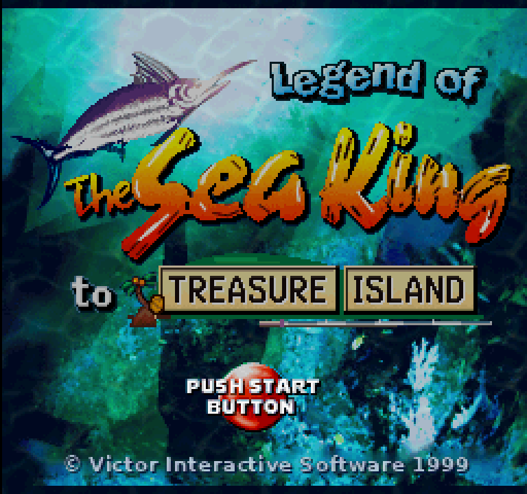

# Legend of the Sea King: To Treasure Island
An English translation of *Umi no Nushi Tsuri: Takarajima ni Mukatte* (PlayStation, 1999, Victor Interactive Software / Pack-In-Soft). The patch translates the whole script (about 1,870 strings) into a new variable-width English font. That covers every fish, bait, gear, food and item name and description, the Fishing Note, the tournaments, the shops and the rankings board. It also adds English name entry and an English family message board keyboard. All Japanese art was redrawn by hand: the title logo, the staff roll and "The End", the faint banner, the Fishing Note and message board headers, the name-entry OK button, the shop plaques and the fish labels on the Fishing Note maps.

## Base game
- Platform: Sony PlayStation (NTSC-J, SLPS-02172)
- Required file: `Umi no Nushi Tsuri - Takarajima ni Mukatte (Japan).bin`, single-track BIN/CUE (MODE2/2352)
- Size / header: 117,844,608 bytes, no header
- CRC32: `DAD222F2` / SHA-1: `ee6bce2a7b06df79c73f69ba8e86a3f5f9f61e0c`
- Patched result: 117,844,608 bytes. CRC32: `563EA50F` / SHA-1: `158cf248e71d3aec9436fddbf0da15c34bab7473`

## How to apply
1. Patch a copy of the .bin with `patches/UmiNoNushiTsuriTakarajima_EN_v1.0.xdelta` using xdelta3, Delta Patcher or Rom Patcher JS.
2. Keep the original .cue. If you rename the .bin, change the FILE line in the .cue to match.

The patched .bin is the same size as the original. Japanese memory card saves keep working.

## Status and testing
Version 1.0. The tester called it done after the version 9 test build.

- **Emulator (Claude):** Beetle PSX (libretro, headless) with a SCPH-5500 BIOS. Seen on screen: the opening story, name entry, file select, status and command menus, every item and gear window, the Fishing Note (levels, fish pages, area maps), the Jetty dialogue, diving, fishing mode, the fish shop (sell all and sell one), the tackle shop, the inn, saving, the boatman, the tournament official and board, the rankings board, the family message board keyboard, the faint banner, and the full staff roll to "The End". Catch, got-away, damage and item messages were checked with the longest names in a string viewer.
- **Emulator (tester):** played the test builds on an emulator, including on a phone, and reported bugs with screenshots. The fixes are in the changelog below.
- **Not tested on real hardware.**
- **Reached only with memory pokes, not normal play:** the shops, faint banner and staff roll were opened by pointing an NPC's code at them, so the scenes around them weren't all played through. Boat travel to the other areas and a natural fish bite were not seen by Claude; the tester caught fish in normal play.

Known issues:
- One shop sign (さかなや) inside the ending movie END2S.STR is still Japanese. Re-encoding the movie was left out on purpose.
- The staff roll names written in kanji only have best-guess readings (listed in DEVLOG.md).
- Eleven Japanese strings with no reference anywhere in the game code (dead text) are left untranslated.

## Build on this
- [src/BUILD.md](src/BUILD.md): how to rebuild the patch from your own copy of the game. A fresh copy of this folder plus the original disc rebuilt the published patch **byte for byte**.
- [docs/ENGINE_NOTES.md](docs/ENGINE_NOTES.md): how the game stores its text, fonts and graphics, with addresses, every hook and the RAM variables found.
- [src/script/script.tsv](src/script/script.tsv): the whole script, Japanese next to English, one row per string.
- [DEVLOG.md](DEVLOG.md): how the patch was made, what was tested, and what went wrong along the way.
- [docs/glossary.md](docs/glossary.md), [docs/characters.md](docs/characters.md): names and terms, following the series glossary shared with the other Nushi Tsuri patches in this repo.

## About AI use
This project was made with substantial help from Claude (Anthropic). Claude did the reverse engineering of the MIPS code and text format, all of the hacking code (variable-width font engine, name entry, message board keyboard, layout fixes), the whole translation, the redrawn graphics, the test tools and the emulator checks. The title logo was drawn by a separate Claude session from the tester's references.

The human tester directed the project, chose the English title and the logo style and approved the final logo, set the series conventions (such as the fish, hook and INN shop plaques used across these hacks), and playtested the builds and reported bugs with screenshots.

## License
Code, tools and docs made for this project: MIT. Translation text and new art: CC BY 4.0. Extracted game material (the Japanese script dump, symbol and file listings, and the original graphics shown for comparison in `src/`) remains the property of its rights holders and is included for research and modding.

The English text font is rendered at build time from DejaVu Sans Bold (Bitstream Vera license); the font itself is not included.

## Credits
- Testing, direction and art direction: the project's tester
- Translation, hacking and graphics: Claude (Anthropic)
- Original game: *Umi no Nushi Tsuri: Takarajima ni Mukatte* © 1999 Victor Interactive Software / Pack-In-Soft. This is an unofficial fan translation. Please distribute the patch, not patched images.
- Fish and gear names follow this repo's *Super Legend of the Sea King* (SFC) translation.
- Font: DejaVu Sans Bold
- Tools: Beetle PSX (libretro) for testing; Keystone and Capstone; OpenCV, NumPy, SciPy and Pillow; xdelta3

## Changelog
- **1.0:** Fishing Note map labels fixed: 65 of 97 labels were on the wrong fish (the Black Porgy said "Bluefin Tuna").
- **Test build 8:** Rankings board: "Treasure Island" no longer wraps to the left edge; columns moved. Fish shop and keep net sell list: the price column stays inside its box. Missing spaces after five speaker names.
- **Test build 7:** Family message board: pencil follows the English text, lines hold up to 27 letters, the Japanese punctuation keys type , . " :
- **Test build 6:** Shop plaques use the series icons (fish, hook, INN).
- **Test build 5:** Shop plaques, shop menu box widened, English Fishing Note map labels, fish page title centred, name-entry cursor and backspace.
- **Test build 4:** Faint banner, staff roll and "The End" in English.
- **Test build 3:** Hand-drawn title logo.
- **Test build 2:** All redrawn art uses hand-built brush lettering instead of system fonts.
- **Test build 1:** First test release: full script, English text engine, name entry, menus.
